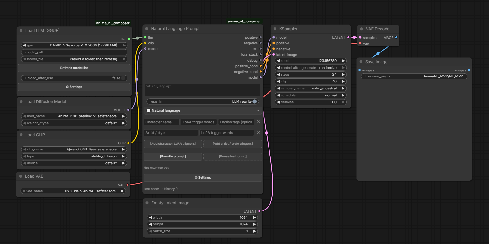
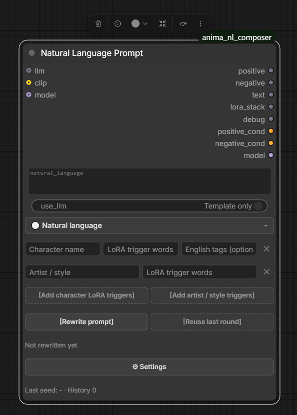
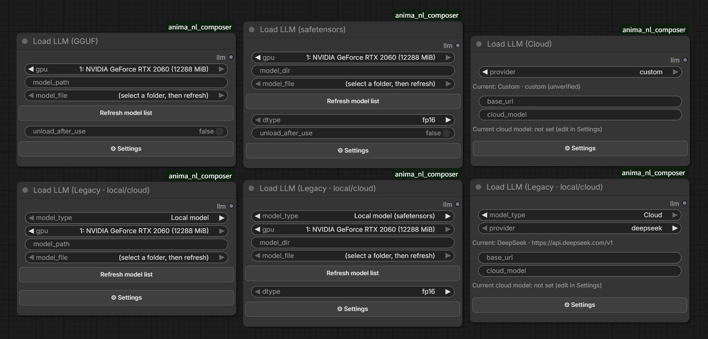
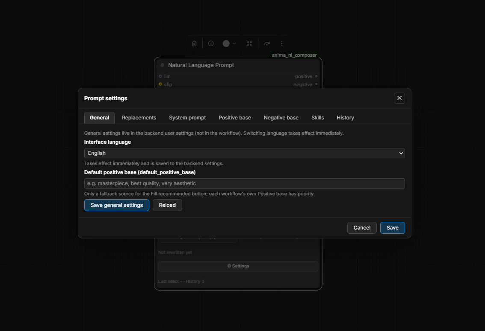
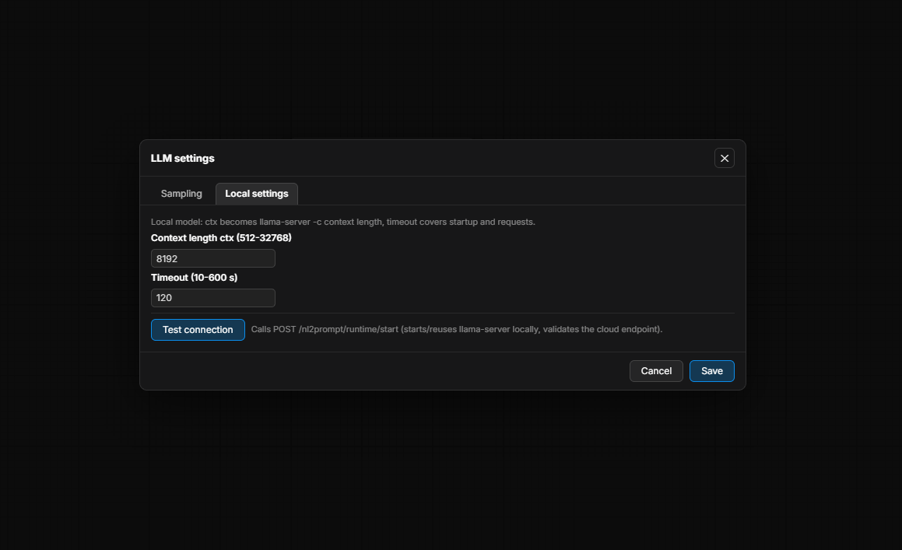
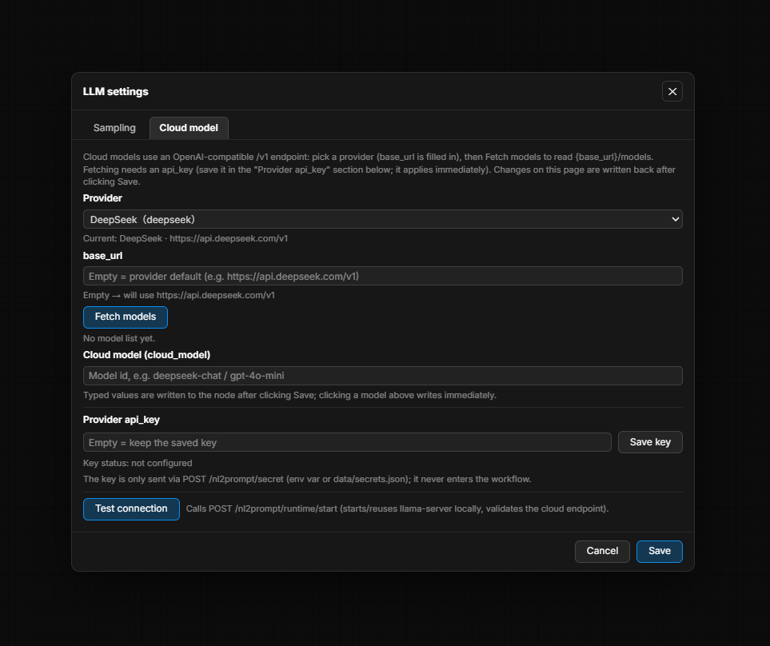
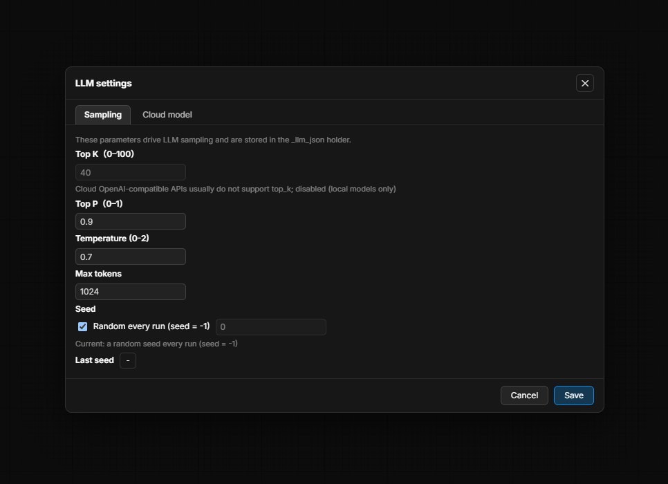

# NL2Prompt · Natural Language Prompt

**Turn one sentence of plain language into a prompt that goes straight into KSampler.**

Type *"a silver-haired girl with red eyes on a rainy neon street, cyberpunk style"* — get a structured English tag prompt plus ready-to-connect `CONDITIONING`, with the trigger words and weights of your configured character / outfit / artist LoRAs injected automatically.

<p>
  <a href="README.md"><b>English</b></a> &nbsp;·&nbsp; <a href="README.zh-CN.md">简体中文</a>
</p>

<p>


</p>



*One sentence + character/style LoRA → two `CONDITIONING` outputs straight into KSampler, saving two `CLIPTextEncode` nodes.*

---

## 1. What it solves

Getting the *right* image out of ComfyUI usually means doing three things at once: **writing the prompt, working out LoRA trigger words, and wiring up a pile of encoding nodes.** All three are fiddly:

- The prompt has to be a tag string tuned to the model, with weights, parentheses and positive/negative sides all correct;
- Character and artist LoRAs each have their own trigger words — miss one and the character drifts;
- `CLIPTextEncode` × 2 plus `LoRA` connections, and the workflow is a mess before you know it.

NL2Prompt folds all three into a single node: **write a sentence, pick your LoRAs, drag the wires into the sampler.**

- 🎯 **Prompt straight into the sampler** — outputs `positive` / `negative` `CONDITIONING`, no `CLIPTextEncode` needed
- 🤖 **Optional LLM rewrite** — local GGUF / local safetensors / 34 cloud APIs; works fine without any LLM
- 🎭 **Semantic LoRA injection** — character, outfit and artist LoRAs, each with trigger words and suggested weights
- ⚙️ **Dedicated settings window** — character library, style library, prompt skills and provider keys all live in one window, not squeezed into node properties
- 🌏 **Bilingual UI** — follows ComfyUI's language automatically, or force one

---

## 2. Features

### 2.1 Prompt assembly

| Capability | Description |
|---|---|
| Natural language parsing | Accepts Chinese and English; extracts subject, action, scene, style, camera |
| Character / outfit / artist injection | Uses trigger words and weights from `characters.json` / `styles.json` |
| Positive / negative base words | Each side has a configurable fixed prefix (quality tags, negative tags), appended automatically |
| Weight syntax | Supports `(tag:1.2)`; out-of-range values are flagged |
| Determinism | Seed support — same input + same seed gives the same result, so runs are reproducible |

**LoRA injection is optional, and it is split in two.** The main node only *works out which LoRAs to use* (the `lora_stack` output); the actual loading is done by the **`LoRA Stack Loader`** node, which applies each LoRA to `MODEL` + `CLIP` in order. If one LoRA is missing or fails to load, it logs a line and skips it — **without breaking the generation**. Skip that node entirely and everything still works.

It also gives you `enabled` to bypass all LoRAs at once, and `strength_scale` to fine-tune every weight globally (0–2) instead of editing each one.



*The main node: 3 inputs on the left (`llm` / `clip` / `model`), 8 outputs on the right, and in the middle the natural-language box, character/style LoRA rows and the rewrite button.*

### 2.2 LLM rewrite (optional)

Three backends — pick one that matches your hardware:

| Node | Backend | Good for |
|---|---|---|
| `NL2Prompt LLM (GGUF)` | llama.cpp / `llama-server.exe` | **Recommended.** Quantised weights; a 9B model fits in 12 GB |
| `NL2Prompt LLM (safetensors)` | HuggingFace transformers | You already have transformers-format weights and have VRAM to spare |
| `NL2Prompt LLM (Cloud)` | Any OpenAI-compatible API | No local compute, or you want a stronger model |

The cloud side ships with **34 provider presets** — drop in an API key and go. You can also fill in `base_url` and a model name yourself to reach any compatible endpoint.



*Three split nodes (GGUF / safetensors / Cloud) plus the three shapes the merged node switches between via `model_type`. One merged node can cover local and cloud, so old workflows keep working.*

Other LLM-related features:

- **Multi-turn history** — keeps the last 20 turns so you can iterate ("change it from the previous version")
- **Quality scoring** — scores the result and retries once if it falls short
- **Prompt skills** — pluggable prompt-engineering spec files that control the LLM's output format and self-checks; import, export, create, delete
- **Auto-unload** — set `unload_after_use` once and the local model's VRAM is released after the rewrite
- **Thinking toggle** — turn off the chain of thought on reasoning models to save tokens and time

### 2.3 Settings window

A standalone floating window (not node properties), opened from the **Settings** button at the bottom of the main node. **7 tabs**:

| Tab | Contents |
|---|---|
| General | Interface language, global default positive base |
| Replacements | Text substitution rules (one word → another) |
| System prompt | The system prompt handed to the LLM |
| Positive base | Positive base words (default prefix) |
| Negative base | Negative base words (default negative prefix) |
| Skills | View / edit / import / export / create / delete prompt skills |
| History | Multi-turn conversation history (last 20, can reuse the previous round) |



*All seven tabs; `Interface language` switches Chinese/English instantly, no restart needed.*

LLM nodes have their own settings window (Sampling / Cloud model / Local settings) — see 5.3.

### 2.4 Bilingual UI

The interface is bilingual with **330 keys** fully covered. The language can follow ComfyUI or be forced.

Switching language updates all of the following **instantly, with no page reload**:

- Node display names in the left-hand node library
- Node titles, and the description shown when you hover over a node
- Dropdown options (e.g. `model_type`, the `model_file` placeholder)
- Provider display names (English uses brand names, `DeepSeek` rather than 「深度求索」)
- Every string in panels and settings windows

> ComfyUI's own language (native node names, context menus) is controlled by ComfyUI's settings and is **independent** of this plugin's language setting. To make both match, switch ComfyUI's locale too.

---

## 3. Installation

### 3.1 Into ComfyUI

```bash
cd <your ComfyUI>/custom_nodes
git clone https://github.com/GQLI-VC/NL2Prompt.git nl2prompt
```

Or just copy this whole directory into `custom_nodes/` and rename it to `nl2prompt`.

### 3.2 Dependencies

**Core features need no third-party packages.** The plugin only uses what ComfyUI already ships: `torch` / `numpy` / `aiohttp`.

Only **local safetensors mode** needs anything extra:

```bash
<your ComfyUI>/python_embeded/python.exe -m pip install transformers accelerate
```

GGUF mode and cloud mode need none of it. See [requirements.txt](requirements.txt).

### 3.3 Restart

Restart ComfyUI and search for `NL2Prompt` in the node library — you should see 6 nodes.

---

## 4. Quick start

`workflows/` contains ready-to-import example workflows:

| File | Description |
|---|---|
| `NL2Prompt_v3_Direct.workflow.json` | **Recommended.** 8-node minimal version: `CONDITIONING` straight into KSampler |
| `NL2Prompt_WithLoRA.workflow.json` | Full flow with the LoRA stack (character / artist LoRAs) |
| `NL2Prompt_MVP.workflow.json` | Minimal flow compatible with v1/v2's `CLIPTextEncode` wiring |

> The minimal version has no LoRA node. When you need character or artist LoRAs, add a **`LoRA Stack Loader`**: feed it the `lora_stack` output of the prompt node, then connect its `model` to KSampler and its `clip` back into the prompt node.

Drag one onto the canvas and wire it up like this:

```
【Load CLIP】── CLIP ──┐
                       ├─→【NL2Prompt Natural Language Prompt】
【LoRA Stack Loader】─ CLIP┘        │
                                    ├─ positive_cond ──→【KSampler】positive
                                    ├─ negative_cond ──→【KSampler】negative
                                    └─ model ─────────→【KSampler】model (optional)
```

You can also take just the `positive` / `negative` strings and feed your own `CLIPTextEncode` (keeps older workflows working).

For the LLM rewrite, connect a `Load LLM` node to the main node's `llm` input. Without it you get pure rule-based assembly, which works just as well.

---

## 5. Configuration

First run generates `plugin/data/settings.json` and `plugin/data/characters.json`. See [settings.example.json](plugin/data/settings.example.json).

### 5.1 Character / style libraries

`plugin/data/characters.json`

```json
{
  "schema": 1,
  "characters": [
    {
      "name": "character name",
      "triggers": ["trigger1", "trigger2"],
      "lora": "your-character-lora.safetensors",
      "weight": 0.9,
      "clip_weight": 0.9
    }
  ]
}
```

`plugin/data/styles.json` has the same structure with artist / style fields. Both can be edited in the settings window — no need to hand-write JSON.

### 5.2 Local models

Two fields on the node face:

- **`model_path`** (GGUF shape) / **`model_dir`** (safetensors shape) — the model root; fill it in, then click **Refresh model list** to populate the `model_file` dropdown
- **`gpu`** — physical GPU (enumerated by `nvidia-smi`). On a dual-GPU machine, bind the LLM to the secondary card and leave the primary for image generation

The `llama-server.exe` path lives in the **plugin's global settings** (not per node) — see `llama_server_path` in `settings.json`.

Click **Settings** on the node to open the LLM settings window; the **Local settings** page controls context length and timeout:



### 5.3 Cloud API key

LLM node → **Settings → Cloud model**: pick a provider → fill in the key → click **Fetch models** to pull the models that endpoint offers → select one.



Keys are stored only in the local `plugin/data/secrets.json`, which is listed in `.gitignore`. They never enter the workflow and are never written to logs.

### 5.4 Sampling parameters

The **Sampling** page of the same window controls LLM sampling: Top K / Top P / Temperature / Max tokens / Seed.



> `top_k` is local-model only. Most cloud OpenAI-compatible APIs do not support it, and the plugin disables the field automatically.

### 5.5 Which LLM mode should I use?

| Your situation | Suggestion |
|---|---|
| 12 GB+ VRAM and you want it offline | **GGUF** — a quantised 9B model is about 5.5 GB, the most reliable option |
| You already have HF-format weights and 16 GB+ VRAM | safetensors |
| Low VRAM, or running in the cloud | Cloud |
| You just want prompt assembly | Skip the LLM entirely |

---

## 6. FAQ

**Q: Does it work without an LLM?**
Yes. The rule engine handles prompt assembly and LoRA injection on its own; the LLM is an optional polishing layer.

**Q: My 12 GB card runs out of memory in safetensors mode?**
That's expected. A 6B safetensors model needs at least ~14 GiB in fp16. Switch to the GGUF node — quantised, it fits in roughly 5.5 GB.

**Q: Why is the node library showing Chinese/English when I set the other language?**
ComfyUI's frontend caches node display names in its own store. If it hasn't caught up after a language switch, press `F5` to refresh.

**Q: The Settings button on my old nodes disappeared?**
v3 renamed node classes but kept the old names registered. If it still misbehaves, check that `custom_nodes/nl2prompt` is a single complete copy and that no older version directory sits alongside it.

**Q: The cloud returns `401`?**
First check in Settings that the provider's API key is actually filled in. With an empty key the plugin reports "key not configured" rather than `401`; a `401` means the key was submitted but the server rejected it.

**Q: Can I use it commercially?**
Personal and internal use is free. Closed-source products and paid SaaS require a commercial licence — see [LICENSING.md](LICENSING.md).

---

## 7. Known limitations

- **VRAM** — a 12 GB card cannot run 6B-class safetensors. Use GGUF.
- **Weight validation** — out-of-range weights **nested** inside parentheses, like `(tag:9.9)`, are not caught (only the outermost level is checked).
- **Provider labels** — provider names stay in their original form in the English UI (brand names are not translated).
- **Node library names** — as noted above, in rare cases a page refresh is needed to sync.
- **LLM quality** — the rewrite depends on the model you pick; small models (≤3B) can still lose detail in complex scene descriptions.

---

## 8. Project structure

```
nl2prompt/
├── plugin/                     # the plugin itself
│   ├── __init__.py             # node registration, legacy class-name compatibility
│   ├── nodes.py                # prompt assembly + LoRA stack + legacy merged LLM node
│   ├── nodes_llm.py            # GGUF / safetensors / cloud LLM nodes
│   ├── runtime.py              # llama-server lifecycle
│   ├── llm_local_hf.py         # local inference via transformers
│   ├── llm_client.py           # cloud API calls
│   ├── routes.py               # backend HTTP routes
│   ├── providers.py            # 34 provider definitions (single source of truth)
│   ├── store.py                # settings and data persistence
│   ├── skill_store.py          # prompt skill management
│   ├── skill_check.py          # skill output validation
│   ├── skills/                 # built-in skill files
│   ├── data/                   # user data (characters/styles/settings, generated at runtime)
│   └── web/                    # frontend
│       ├── i18n.js             # zh/en strings
│       ├── common.js           # shared utilities and settings-window scaffolding
│       ├── nl2prompt_composer.js
│       └── nl2prompt_load_llm.js
├── workflows/                  # example workflows (v3 direct / with LoRA / MVP compatible)
├── tests/                      # automated tests
├── tools/                      # development and verification tools
├── docs/                       # documentation (interface contract, dev notes, screenshots)
├── LICENSE                     # full AGPL-3.0 text
├── LICENSING.md                # dual-licensing explanation
├── LICENSE-COMMERCIAL.md       # commercial licence template
├── CHANGELOG.md
└── requirements.txt
```

---

## 9. License

This project is **dual-licensed: AGPL-3.0 + commercial**:

| Your situation | License |
|---|---|
| Personal use, learning, internal tooling | **Free** (AGPL-3.0) |
| Integrating into an open-source project | **Free** (must also be released under AGPL-3.0) |
| Closed-source product / paid SaaS | **Commercial licence required** |

If you distribute a modified version, you must keep the copyright notice, mark the changed files and release under the same licence (AGPL-3.0 §5). Offering it as a network service triggers the same source-release obligation (§13).

Full explanation in [LICENSING.md](LICENSING.md); licence text in [LICENSE](LICENSE).

```
Copyright (C) 2026 GQLI-VC
```

---

## 10. Acknowledgements

The **UI interaction patterns** here were inspired by two other ComfyUI plugins, both of which are worth a look:

- [nregret/Comfyui-Anima-Tools](https://github.com/nregret/Comfyui-Anima-Tools) (MIT, declared in `pyproject.toml`) — the two-column prompt editing layout
- [n0va39/ComfyUI-EasyUseAnima](https://github.com/n0va39/ComfyUI-EasyUseAnima) (GPL-3.0) — the standalone settings-window approach

**No code from either project was copied.** A line-by-line comparison (3–5 line sliding-window n-gram detection) found zero matching blocks and an empty intersection of unique identifiers. Only general design patterns were borrowed — a hidden holder widget and a standalone settings dialog — and design patterns are not copyrightable. Details in [LICENSING.md §4](LICENSING.md).

Thanks also to the ComfyUI community and the llama.cpp project.

See [CONTRIBUTORS.md](CONTRIBUTORS.md) for who did what, human and AI.

---

## 11. About this document

This document (the README, CHANGELOG and everything under `docs/`) was **written with AI assistance** and then reviewed and verified by hand — every screenshot is taken from the plugin actually running, and the feature descriptions are backed by automated tests.

That said, UI layout, defaults and parameter names can shift between versions. **What actually matters is how the plugin behaves in your own ComfyUI** — treat the running instance as the source of truth. If you find the docs disagree with reality, please [open an issue](https://github.com/GQLI-VC/NL2Prompt/issues); that kind of feedback is especially valuable.

> The fastest way to check that installation worked: drag in `workflows/NL2Prompt_v3_Direct.workflow.json` and run it.
