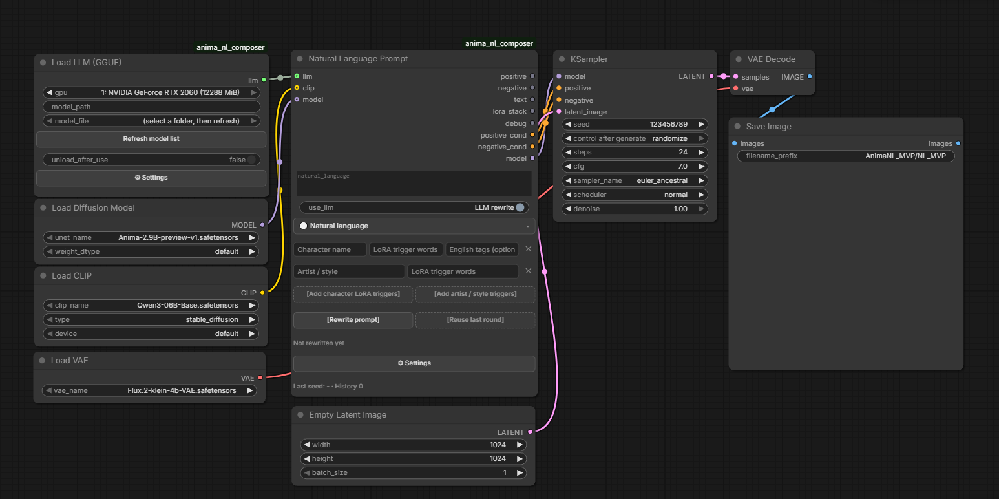
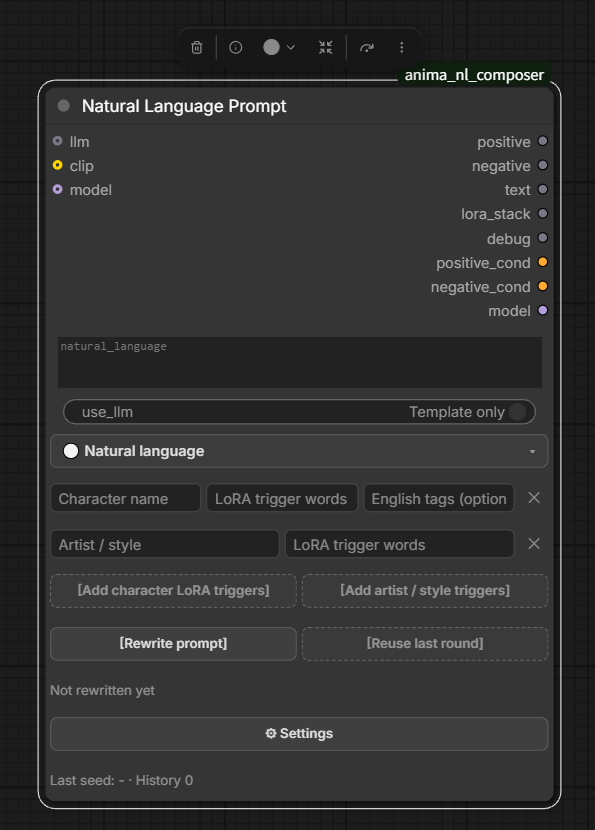
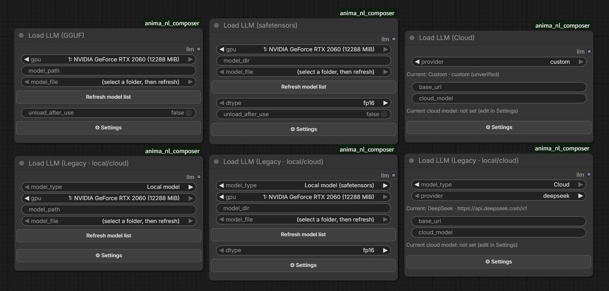
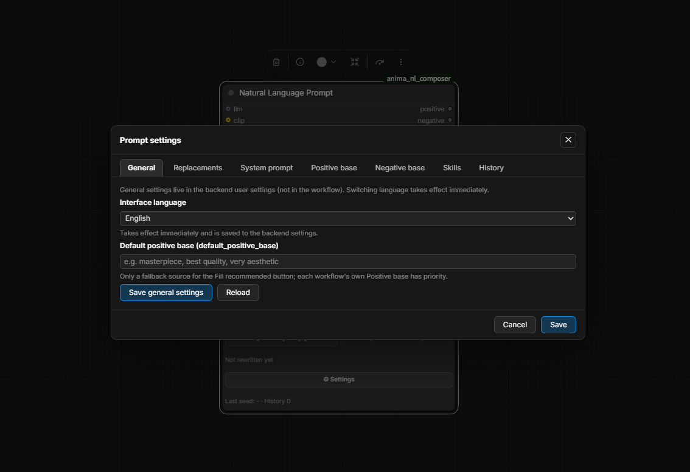
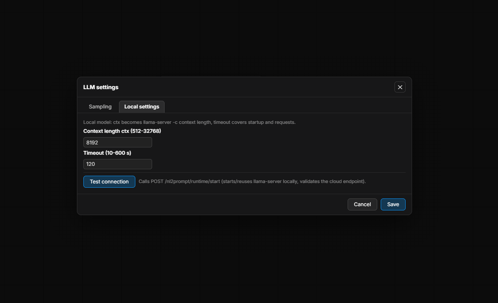
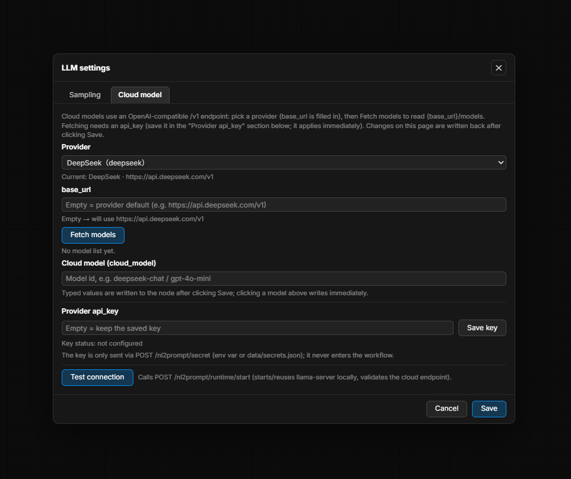
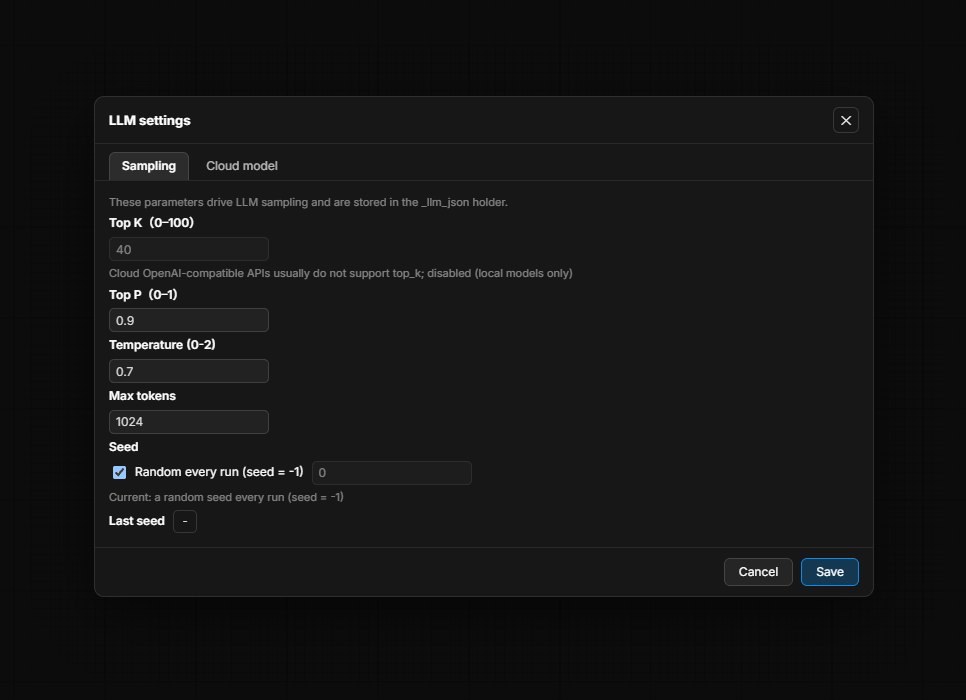

# NL2Prompt · 自然语言提示词

**把一句人话变成可直接送进 K 采样器的提示词。**

<p>
  <a href="README.md">English</a> &nbsp;·&nbsp; <a href="README.zh-CN.md"><b>简体中文</b></a>
</p>

输入「银发红瞳的少女站在雨夜霓虹街头，赛博朋克风格」，输出结构化的英文 tag 提示词 + 可直接连接的 `CONDITIONING`，同时自动注入你配置的角色 / 服装 / 画师 LoRA 触发词与权重。

<p>


</p>



*一句话 + 角色/风格 LoRA → 两路 `CONDITIONING` 直接进 KSampler，省掉两个 `CLIPTextEncode` 节点。*

---

## 1. 它解决什么问题

ComfyUI 里画一张「对的」图，通常要做三件事：**想提示词、拼 LoRA 触发词、拉一堆连线的编码节点**。这三件事都很碎：

- 提示词要按模型偏好写成 tag 串，权重、括号、正负向都要对；
- 角色 / 画师 LoRA 有各自的触发词，漏一个人物就走形；
- `CLIPTextEncode` × 2 + `LoRA` 连线，工作流很快就成一团。

NL2Prompt 把这三步收进一个节点：**写一句话，选好 LoRA，直接把线拉到采样器**。

- 🎯 **提示词直连采样器** — 输出 `positive` / `negative` 两路 `CONDITIONING`，不用再连 `CLIPTextEncode`
- 🤖 **可选 LLM 改写** — 本地 GGUF / 本地 safetensors / 34 家云端 API，三种后端任选；不接 LLM 也能用
- 🎭 **LoRA 语义注入** — 角色、服装、画师三类 LoRA，自动带触发词和推荐权重
- ⚙️ **独立设置面板** — 角色库、风格库、提示词技能、供应商密钥，都在一个窗口里管，不挤节点属性
- 🌏 **中英双语** — 跟随 ComfyUI 语言自动切换，也可强制指定

---

## 2. 功能特性

### 2.1 提示词组装

| 能力 | 说明 |
|---|---|
| 自然语言解析 | 中英文都认，提取人物、动作、场景、风格、镜头 |
| 角色 / 服装 / 画师注入 | 按 `characters.json` / `styles.json` 的配置带触发词和权重 |
| 正向 / 负向基础词 | 两端各有一段可配置的固定前缀（画质词、负面词），自动拼接 |
| 权重语法 | 支持 `(tag:1.2)`，越界会给出提示 |
| 确定性 | 支持 seed，同一输入 + 同 seed 结果稳定，便于复现 |

**LoRA 注入是可选的、且拆成两半**：主节点只负责*算出该用哪些 LoRA*（输出 `lora_stack` 列表），真正加载由 **`LoRA 堆栈加载`** 节点完成 —— 它把每个 LoRA 依次打进 `MODEL` + `CLIP`，单个 LoRA 找不到或加载失败只打印一行日志然后跳过，**不会中断出图**。不接这个节点也能正常生成。

它还提供 `enabled` 一键旁路全部 LoRA、`strength_scale` 全局微调强度（0–2），不用逐个改权重。



*主节点正面：左侧 3 个输入（`llm` / `clip` / `model`），右侧 8 个输出，中间是自然语言输入框、角色/风格 LoRA 行与「重写提示词」按钮。*

### 2.2 LLM 重写（可选）

三种后端，按你的硬件选：

| 节点 | 后端 | 适用 |
|---|---|---|
| `NL2Prompt LLM (GGUF)` | llama.cpp / `llama-server.exe` | **推荐**。量化权重，12 GB 显存够跑 9B |
| `NL2Prompt LLM (safetensors)` | HuggingFace transformers | 已有 transformers 格式权重、显存充裕时 |
| `NL2Prompt LLM (Cloud)` | 任意 OpenAI 兼容 API | 没有本地算力，或想要更强的模型 |

云端部分内置 34 家供应商预设，填 API Key 即可用；也可以自己填 `base_url` 和模型名，接入任何兼容接口。



*三种拆分节点（GGUF / safetensors / Cloud）+ 合并版按 `model_type` 切换出的三种形态。合并版一个节点即可覆盖本地与云端，旧工作流不会失效。*

其他 LLM 相关能力：

- **多轮历史** — 保留最近 20 轮对话，可以「接着上一版改」
- **质量评分** — 对生成结果打分，低分自动重试一次
- **提示词技能（skill）** — 可插拔的提示词工程规范文件，控制 LLM 的输出格式与自检项；支持导入、导出、新建、删除
- **自动卸载** — 设一次 `unload_after_use`，重写完成后自动释放本地模型占用的显存
- **思考模式开关** — 对 reasoning 模型可关闭思维链，省 token 也更快

### 2.3 设置面板

独立浮窗（不是节点属性），位于主节点正面底部的 Settings 按钮。**7 个标签页**：

| 标签页 | 内容 |
|---|---|
| General | 界面语言、全局默认正面基础词 |
| Replacements | 文字替换规则（一个词换成另一个词） |
| System prompt | 传给 LLM 的系统提示词 |
| Positive base | 正面基础词（默认前缀） |
| Negative base | 负面基础词（默认负向前缀） |
| Skills | 提示词技能的查看 / 编辑 / 导入导出 / 新建删除 |
| History | 多轮对话历史（最近 20 轮，可沿用上一轮结果） |



*七个标签页全在这里；`Interface language` 可即时切换中英，不用重启。*

LLM 节点另有自己的设置窗口（Sampling / Cloud model / Local settings），见 5.3。

### 2.4 双语界面

界面文案中英双语，**330 个键位**全覆盖。语言可跟随 ComfyUI 主界面，也可强制指定。

切换语言时以下内容**即时同步，无需刷新页面**：

- 左侧节点栏里的节点显示名
- 节点标题、以及鼠标悬停在节点上出现的描述
- 下拉选项（如 `model_type`、`model_file` 的占位项）
- 供应商显示名（英文界面用品牌名，如 `DeepSeek` 而非「深度求索」）
- 面板与设置窗口内的全部文案

> ComfyUI 自身的语言（原生节点名、右键菜单）由 ComfyUI 的设置控制，与本插件的语言设置**相互独立**。想两边一致，需要在 ComfyUI 设置里也切一次。

---

## 3. 安装

### 3.1 放进 ComfyUI

```bash
cd <你的ComfyUI>/custom_nodes
git clone https://github.com/GQLI-VC/NL2Prompt.git nl2prompt
```

或者直接把这个目录整个复制进 `custom_nodes/`，重命名为 `nl2prompt`。

### 3.2 依赖

**核心功能不需要装任何第三方包**，插件只用 ComfyUI 自带的 `torch` / `numpy` / `aiohttp`。

只有 **本地 safetensors 模式**需要额外依赖：

```bash
<你的ComfyUI>/python_embeded/python.exe -m pip install transformers accelerate
```

GGUF 模式与云端模式都不需要这些。详见 [requirements.txt](requirements.txt)。

### 3.3 重启

重启 ComfyUI，在节点栏里搜索 `NL2Prompt` 即可看到 6 个节点。

---

## 4. 快速开始

`workflows/` 目录里有可直接导入的示例工作流：

| 文件 | 说明 |
|---|---|
| `NL2Prompt_v3_Direct.workflow.json` | **推荐**。8 节点精简版：`CONDITIONING` 直接进 KSampler |
| `NL2Prompt_WithLoRA.workflow.json` | 带 LoRA 堆叠的完整流程（角色 / 画师 LoRA） |
| `NL2Prompt_MVP.workflow.json` | 最小可用流程（兼容 v1/v2 的 `CLIPTextEncode` 接法） |

> 精简版里没有 LoRA 节点。需要角色或画师 LoRA 时，加一个 **`LoRA 堆栈加载`** 节点：把 `自然语言提示词` 的 `lora_stack` 输出接进它，再把它的 `model` 接到 KSampler、`clip` 接回 `自然语言提示词`。

拖进 ComfyUI 画布后，按下图接线即可：

```
【加载CLIP】── CLIP ──┐
                      ├─→【NL2Prompt 自然语言提示词】
【LoRA 堆栈加载】─ CLIP┘        │
                                ├─ positive_cond ──→【K采样器】positive
                                ├─ negative_cond ──→【K采样器】negative
                                └─ model ─────────→【K采样器】model（可选）
```

也可以只取 `positive` / `negative` 两路文本，自己接 `CLIPTextEncode`（兼容老工作流）。

想要 LLM 改写的效果，把 `加载LLM` 节点接进主节点的 `llm` 输入即可；不接就是纯规则组装，一样能用。

---

## 5. 配置

首次运行会自动生成 `plugin/data/settings.json` 与 `plugin/data/characters.json`。参考 [settings.example.json](plugin/data/settings.example.json)。

### 5.1 角色库 / 风格库

`plugin/data/characters.json`

```json
{
  "schema": 1,
  "characters": [
    {
      "name": "角色名",
      "triggers": ["触发词1", "触发词2"],
      "lora": "角色LoRA的文件名.safetensors",
      "weight": 0.9,
      "clip_weight": 0.9
    }
  ]
}
```

`plugin/data/styles.json` 结构相同，字段换成画师 / 风格。两者在设置面板里都能直接增删改，不用手写 JSON。

### 5.2 本地模型

节点正面有两个字段：

- **`model_path`**（GGUF 形态）/ **`model_dir`**（safetensors 形态）— 模型根目录，填好后点节点上的 **Refresh model list** 扫描出 `model_file` 下拉
- **`gpu`** — 物理 GPU（`nvidia-smi` 枚举），双卡机器建议把 LLM 绑到副卡，主卡留给出图

`llama-server.exe` 的路径在**插件全局设置**里配（不是每个节点），见 `settings.json` 的 `llama_server_path`。

点节点上的 **Settings** 打开 LLM 设置窗口，**Local settings** 页可调上下文长度与超时：



### 5.3 云端 API Key

LLM 节点的 **Settings → Cloud model**：选供应商 → 填 Key → 点 **Fetch models** 拉取该服务端可用模型 → 选中即可。



密钥只保存在本地 `plugin/data/secrets.json`，已列入 `.gitignore`，不会进入工作流、也不会写进日志。

### 5.4 采样参数

同一窗口的 **Sampling** 页控制 LLM 的采样：Top K / Top P / Temperature / Max tokens / Seed。



> `top_k` 是本地模型专属；多数云端 OpenAI 兼容接口不支持，插件会自动禁用该项。

### 5.5 该选哪种 LLM 模式

| 你的情况 | 建议 |
|---|---|
| 有 12 GB 以上显存、想要离线 | **GGUF**，量化后 9B 模型约 5.5 GB，最稳 |
| 已有 HF 格式权重、显存 ≥ 16 GB | safetensors |
| 显存小、或在云上跑 | 云端 |
| 只是想拼提示词 | 不用接 LLM |

---

## 6. 常见问题

**Q：不接 LLM 能用吗？**
能。规则引擎本身就负责提示词组装和 LoRA 注入，LLM 只是可选的「润色层」。

**Q：我的 12 GB 卡跑 safetensors 模式报 OOM？**
这是预期内的。6B 的 safetensors 模型 fp16 至少需要约 14 GiB。请改用 GGUF 节点，量化后能压到 5.5 GB 左右。

**Q：为什么节点栏里的节点名是中文/英文，和我设置的语言不一致？**
ComfyUI 前端把节点显示名缓存在自己的 store 里。切换语言后若未同步，按 `F5` 刷新一次页面即可。

**Q：旧工作流打开后节点上的设置按钮不见了？**
v3 改过节点类名，但保留了旧类名的注册。如果仍异常，请确认 `custom_nodes/nl2prompt` 是完整的一份，且没有和旧版目录同时存在。

**Q：云端返回 `401`？**
先在设置面板确认该供应商的 API Key 已填写。密钥为空时插件会给出「未配置密钥」的提示，而不是 `401`；如果你看到 `401`，说明 Key 已提交但被服务端判为无效。

**Q：能在商业项目里用吗？**
个人与内部使用免费。闭源产品或付费 SaaS 需要商业授权，见 [LICENSING.md](LICENSING.md)。

---

## 7. 已知限制

- **显存**：12 GB 显卡跑不动 6B 级 safetensors，请用 GGUF。
- **权重校验**：`(tag:9.9)` 这类**嵌套**在括号里的越界权重不会被校验器拦下（只检查最外层）。
- **供应商标签**：供应商名称在英文界面下仍显示中文原名（品牌名不做翻译）。
- **节点栏名称**：如前所述，极端情况下需刷新页面才会同步。
- **LLM 质量**：改写效果取决于所选模型，小模型（≤3B）在复杂场景描述上仍可能丢细节。

---

## 8. 项目结构

```
nl2prompt/
├── plugin/                     # 插件本体
│   ├── __init__.py             # 节点注册、旧类名兼容
│   ├── nodes.py                # 提示词组装 + LoRA 堆叠 + 旧版合并 LLM 节点
│   ├── nodes_llm.py            # GGUF / safetensors / 云端 三种 LLM 节点
│   ├── runtime.py              # llama-server 生命周期管理
│   ├── llm_local_hf.py         # transformers 本地推理
│   ├── llm_client.py           # 云端 API 调用
│   ├── routes.py               # 后端 HTTP 路由
│   ├── providers.py            # 34 家供应商定义（单一真源）
│   ├── store.py                # 设置与数据持久化
│   ├── skill_store.py          # 提示词技能管理
│   ├── skill_check.py          # 技能输出校验
│   ├── skills/                 # 内置技能文件
│   ├── data/                   # 用户数据（角色/风格/设置，运行时生成）
│   └── web/                    # 前端
│       ├── i18n.js             # 中英文案
│       ├── common.js           # 共用工具与设置窗口骨架
│       ├── nl2prompt_composer.js
│       └── nl2prompt_load_llm.js
├── workflows/                  # 示例工作流（v3 直连 / 带 LoRA / MVP 兼容）
├── tests/                      # 自动化测试
├── tools/                      # 开发与校验工具
├── docs/                       # 文档（接口契约、开发记录、截图）
├── LICENSE                     # AGPL-3.0 全文
├── LICENSING.md                # 双许可说明
├── LICENSE-COMMERCIAL.md       # 商业授权模板
├── CHANGELOG.md
└── requirements.txt
```

---

## 9. 许可证

本项目采用 **AGPL-3.0 + 商业双许可**：

| 场景 | 许可 |
|---|---|
| 个人使用、学习、内部工具 | **免费**（AGPL-3.0） |
| 开源项目集成 | **免费**（需同样以 AGPL-3.0 发布） |
| 闭源产品 / 付费 SaaS | **需商业授权** |

基于本项目代码修改后分发，必须保留版权声明、标注修改，并以同一许可发布（AGPL-3.0 §5）。通过网络提供服务同样触发源码开放义务（§13）。

完整说明见 [LICENSING.md](LICENSING.md)，许可证全文见 [LICENSE](LICENSE)。

```
Copyright (C) 2026 GQLI-VC
```

---

## 10. 致谢

本项目的**界面交互范式**参考了以下两个 ComfyUI 插件，它们的思路很有价值：

- [nregret/Comfyui-Anima-Tools](https://github.com/nregret/Comfyui-Anima-Tools)（MIT，声明于 `pyproject.toml`）— 提示词双栏编辑的交互设计
- [n0va39/ComfyUI-EasyUseAnima](https://github.com/n0va39/ComfyUI-EasyUseAnima)（GPL-3.0）— 独立设置浮窗的组织方式

**本项目未复制任何上述项目的代码**。经逐行比对（3–5 行滑动窗口 n-gram 检测），代码块重合数为 0，唯一标识符交集为空。仅借鉴了「隐藏占位控件 + 独立设置浮窗」这类通用设计模式，而设计模式不受著作权保护。详见 [LICENSING.md §4](LICENSING.md)。

同时感谢 ComfyUI 社区与 llama.cpp 项目。

具体分工（人与 AI）见 [CONTRIBUTORS.md](CONTRIBUTORS.md)。

---

## 11. 关于本文档

本文档（含 README、CHANGELOG 与 `docs/` 下的说明）由 **AI 辅助撰写**，并经过人工核对与实测验证——文中所有截图均截自插件的真实运行界面，功能描述有对应的自动化测试覆盖。

但界面布局、默认值、参数名可能随版本演进发生调整，**实际效果请以插件在你的 ComfyUI 中运行的结果为准**。如果发现文档与实机不符，欢迎提 [Issue](https://github.com/GQLI-VC/NL2Prompt/issues) 指正——这类反馈对项目尤其有价值。

> 验证安装是否成功最快的办法：直接拖入 `workflows/NL2Prompt_v3_Direct.workflow.json` 跑一遍。
